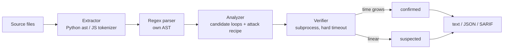

# redoscope

[](https://github.com/Nithinfgs/redoscope/actions/workflows/ci.yml)
[](LICENSE)


**Find regular expressions that hang your program, and prove it.**

Most ReDoS scanners tell you a pattern *looks* dangerous. redoscope builds an attack
string for it, runs your real regex engine (CPython `re`, or V8 via Node) in a
killable subprocess, and measures how the time grows. A finding is `confirmed` only
when the engine actually slowed down; otherwise it stays `suspected` and is hidden by default.

## Why

Catastrophic backtracking (CWE-1333) keeps showing up in CVEs, including in AI
infrastructure in 2026 (for example CVE-2026-15154 and CVE-2026-34939). Regexes are
hard to eyeball, and more of them are now written by coding agents and merged unread.
Static-only tools are noisy, so people stop looking at their output. Measured evidence
is hard to argue with. See [docs/RESEARCH.md](docs/RESEARCH.md) for the research behind this project.

## Install

Requires Python 3.10+. Node.js is optional and only needed to verify JavaScript/TypeScript regexes.

```bash
git clone https://github.com/Nithinfgs/redoscope.git
cd redoscope
pip install .
```

## Quick start

```bash
redoscope scan examples
```

Real output from this repository's `examples/` folder:

```text
redoscope 0.1.0: 2 files, 7 regexes, 5.1s

CONFIRMED  exponential  examples/vulnerable.js:2:15
  pattern: ^([a-zA-Z0-9]+[._-]?)+@example\.com$
  why:     nested unbounded loops: the same input can be split between iterations in many ways
  proof:   time grew 4.0x for every 2 extra characters; n=36 took 1052 ms (v8, attack suffix '!')

CONFIRMED  polynomial (degree 2)  examples/vulnerable.py:9:22
  pattern: ^\d+\d+$
  why:     2 adjacent unbounded loops can match the same characters
  proof:   time grows ~n^1.9; n=16000 took 817 ms (python, attack suffix '!')

4 confirmed, 0 suspected
```

(Two more findings are in the full output. Timings vary by machine.)
The safe patterns in `examples/` (including a scary-looking quoted-string regex) are not
reported, and the `# redoscope: ignore` line is skipped.

Check one pattern:

```bash
redoscope check '^(a+)+$'
redoscope check '^\w+(?:\s\w+)*\s?$'      # the fixed version: no risk found
redoscope check '^(x+x+)+y$' --engine v8
```

## Usage

```text
redoscope scan PATH [PATH ...] [--format text|json|sarif] [--fail-on confirmed|suspected|never]
                    [--no-verify] [--show-suspected] [--budget SECONDS] [--exclude GLOB]
redoscope check PATTERN [--engine python|v8] [--flags imsx] [--budget SECONDS] [--no-verify]
```

| Option | Meaning |
|---|---|
| `--fail-on` | Exit code 1 when findings of this level exist. Default `confirmed`. |
| `--no-verify` | Static analysis only. Every finding is `suspected`. |
| `--show-suspected` | Also list findings the engine did not slow down on. |
| `--budget` | Hard time limit in seconds per verification attempt (default 4). |
| `--exclude` | Glob of files to skip. Repeatable. |

Exit codes: `0` clean, `1` findings at the `--fail-on` level, `2` usage error.

Silence a known regex with a comment on the same or previous line: `# redoscope: ignore`
or `// redoscope: ignore`.

Directories such as `.git`, `node_modules`, `.venv`, `dist` and `build` are skipped automatically.

### CI and GitHub code scanning

```yaml
- run: pip install git+https://github.com/Nithinfgs/redoscope.git
- run: redoscope scan src --format sarif > redoscope.sarif || true
- uses: github/codeql-action/upload-sarif@v3
  with: { sarif_file: redoscope.sarif }
```

Or simply `redoscope scan src` as a gate: it fails the build only on confirmed findings.

## How it works



1. **Extract** regexes from `re.*` calls (constant strings, flags) in Python and from regex
   literals and `new RegExp("...")` in JS/TS.
2. **Parse** them into a small AST (character sets, groups, alternation, quantifiers).
3. **Analyze**: nested unbounded loops, overlapping alternatives inside a loop, nullable
   loop bodies, and adjacent loops over the same characters. Each candidate carries a
   prefix that reaches the loop and a character to repeat.
4. **Verify**: repeat that character with a failing suffix, time the engine at growing
   sizes, and classify the growth as exponential (time multiplies per extra character) or
   polynomial (log-log slope of at least ~1.7). A runaway run is killed and the timeout is itself evidence.

Matching is attempted from the start of the string (`match`), so the unavoidable
"every start position is tried" cost of unanchored `search` is not reported as a finding.

## Limitations

- Only Python (`re` call sites with constant patterns) and JS/TS are scanned. Go and Rust
  use linear-time engines. Java, PHP, Ruby, .NET, and the third-party `regex` module's
  extra syntax are not modelled.
- Patterns built at runtime are counted but not analyzed.
- The parser covers common syntax; conditionals and some exotic constructs are reported as
  skipped, never guessed.
- Static candidates are heuristic. Patterns with backreferences, lookarounds that matter to
  matching, or polynomial cost between non-adjacent loops can be missed (false negatives).
- Verification runs one attack family. A pattern that is only slow on a different input
  shape can stay unflagged.
- Verification uses the Python interpreter running redoscope and the `node` on your PATH;
  other versions of those engines can behave differently (for example V8 and
  Python 3.11+ atomic groups).
- Timing results vary by machine, and the JS tokenizer guesses regex-versus-division from the
  previous token, so a regex right after `)` may be missed.
- Not tested against an external corpus beyond the CPython 3.12 standard library, where it
  confirmed two quadratic patterns in `platform.py` and confirmed none as exponential.

## Testing

```bash
pip install -e ".[dev]"
pytest -q
ruff check . && ruff format --check .
mypy src
```

The suite includes real engine runs, so it takes about 20 seconds. Tests that need Node
are skipped when it is not installed.

## Roadmap

- Optional auto-fix suggestions for common shapes.
- Java, PHP, Ruby and Go (`regexp` is safe, but `pcre` bindings are not) extractors.
- Unanchored-`search` quadratic mode behind a flag.
- Pre-commit hook and a GitHub Action wrapper.
- Longer-input confirmation for patterns near the polynomial threshold.

## Contributing

See [CONTRIBUTING.md](CONTRIBUTING.md). Issues with a regex that was wrongly flagged or
missed are the most useful reports.

## License

MIT, see [LICENSE](LICENSE).
